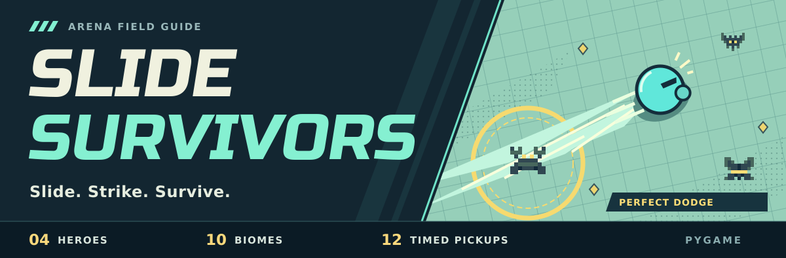
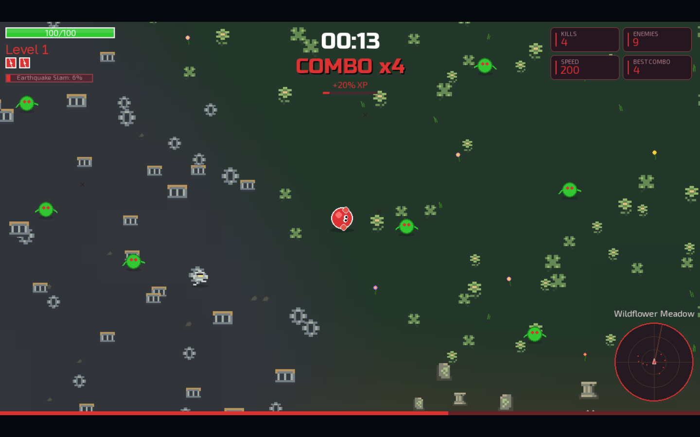
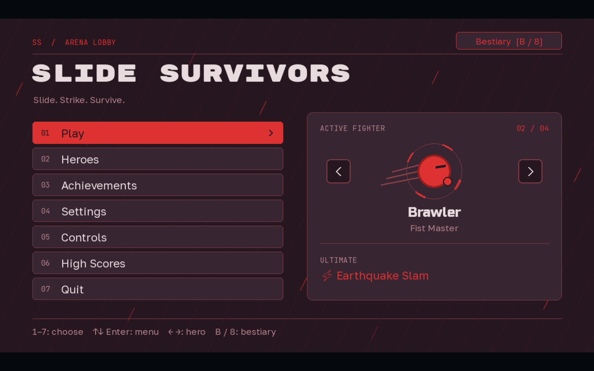
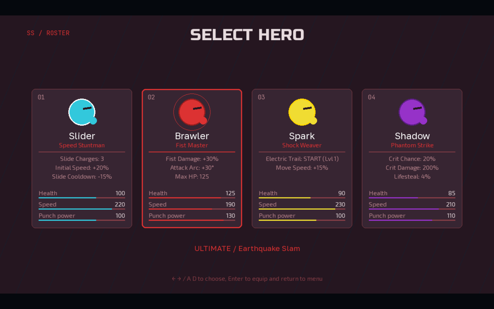
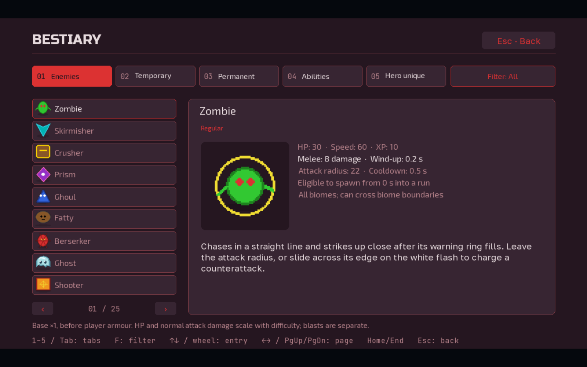
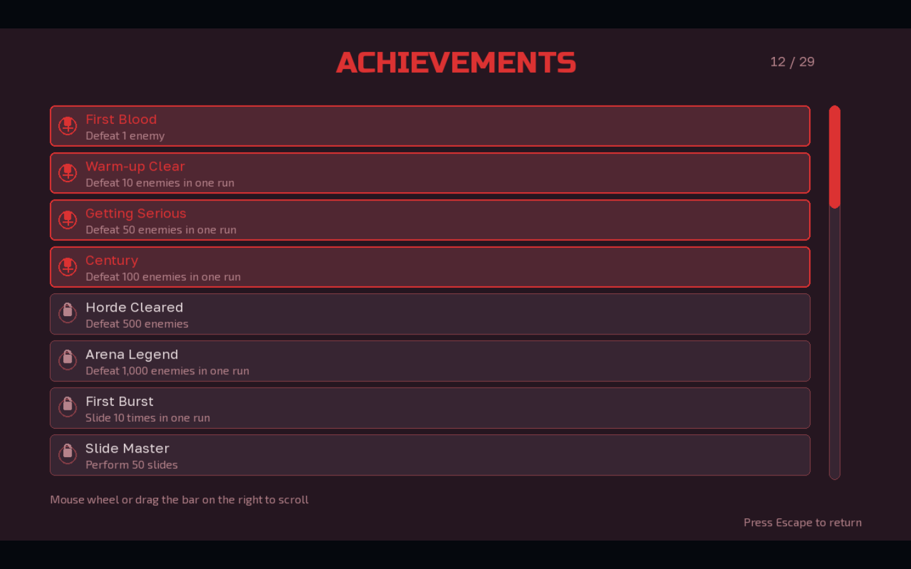
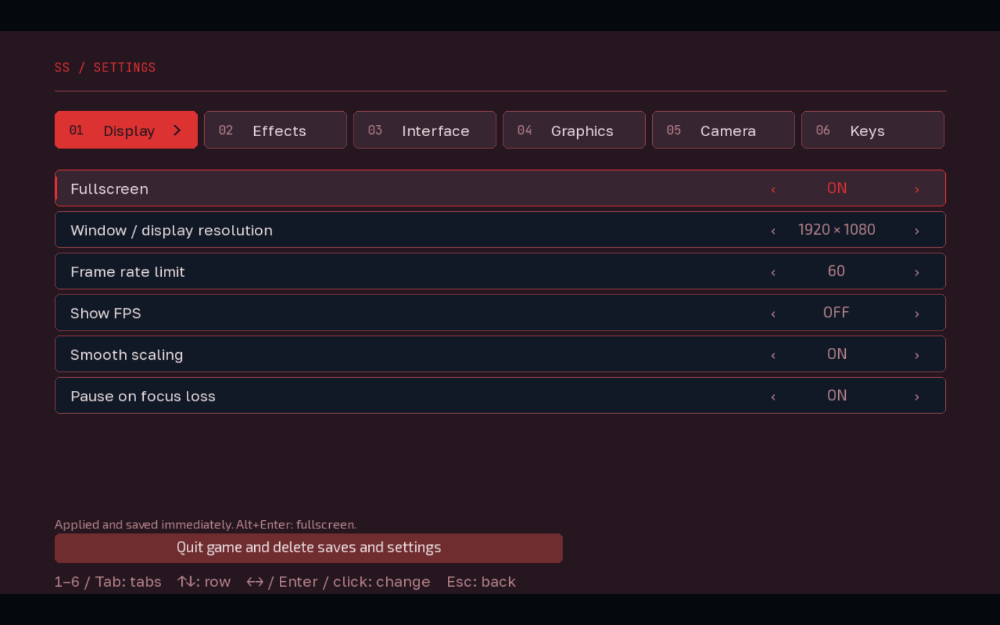
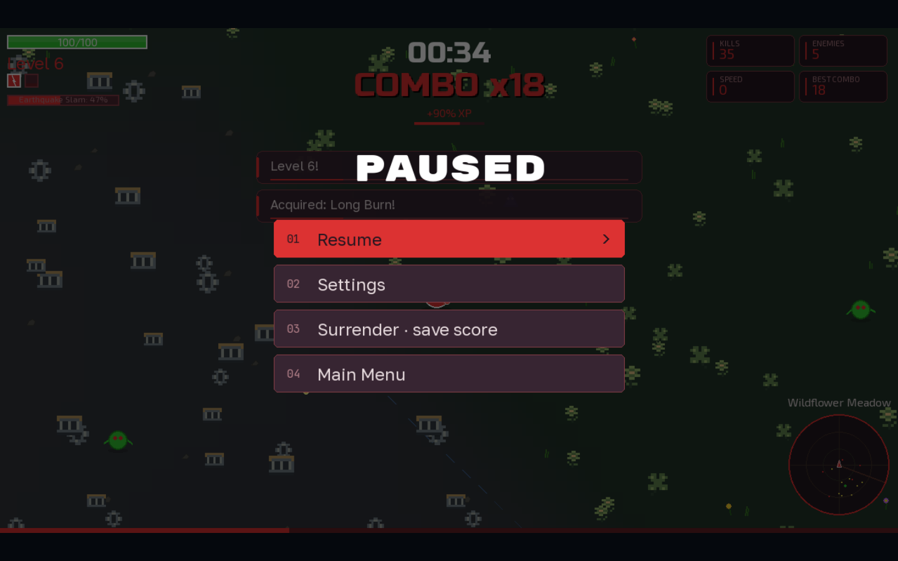
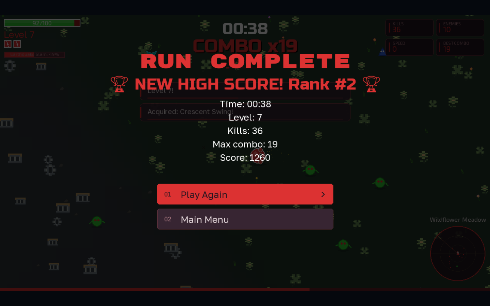

**English** · [Русский](README.ru.md)

# Slide Survivors

A top-down arena roguelike built with Pygame. Your hero punches automatically; you aim the fists and steer the slide. Slip past a crab just before its attack lands, turn back with a charged cleave, and collect the XP before the next wave reaches you.

## Screenshots

| Gameplay | Main menu |
| :---: | :---: |
|  |  |
| **Hero selection** | **Bestiary** |
|  |  |
| **Achievements** | **Settings** |
|  |  |
| **Pause menu** | **Run results** |
|  |  |

## Start a run

From the project directory, with Python 3 and pip installed:

```bash
python -m pip install -r requirements.txt
python main.py
```

Choose English or Russian on first launch. Equip **Slider**, **Brawler**, **Spark**, or **Shadow** in **Heroes**, or cycle through them using the arrows on the lobby card. Choosing a hero doesn't start the clock: press **1 — Play** when you're ready. Fonts for both languages, symbols, and monochrome emoji ship with the game; no system font setup is needed.

## Controls

| Action | Input |
| --- | --- |
| Move and aim | WASD or arrow keys to move; mouse to aim |
| Slide | Hold Space or Shift; release to stop |
| Ultimate | Q or right-click when charged |
| Choose an upgrade | 1–3, click a card, or use Left/Right and Enter |
| Pause | Esc or P |

In numbered menus, the matching digit works like a click (top row or keypad). In Settings, **1–6 select tabs** instead; Up/Down select a row, Left/Right or Enter change its value, and Esc goes back. **Pause → Surrender** ends the run and submits the result to the same local leaderboard as a defeat.

## Display, effects and accessibility

Drag the window edges to resize it, or choose a resolution and fullscreen in **Settings → Display**. **Alt+Enter** toggles fullscreen. The game preserves its 16:9 canvas with letterboxing; clicks, aiming and trainer controls are mapped to the scaled image. Unsupported display modes fall back to a 1280×720 window.

Settings have six tabs, selected with **1–6** (including keypad), **Tab / Shift+Tab**, or mouse:

- **Display:** fullscreen, resolution, 30–240 FPS or unlimited, FPS counter, smooth scaling, pause on focus loss.
- **Effects:** particle density (off to 3×, default 2×), particle budget, camera shake, screen flashes, slide trails and particles, biome decorations, off-screen culling.
- **Interface:** language, minimap, radar sweep, damage numbers, notifications, run statistics.
- **Graphics:** terrain detail, biome transition width, terrain shading, decoration density and animation, entity shadows, radar pickup markers.
- **Camera:** camera smoothing and look-ahead, menu animations, independent hero switching animation, crosshair, notification duration.

Changes apply immediately and are saved locally. Off-screen culling is **view culling**, not 3D occlusion: it skips rendering invisible objects without stopping their simulation. The particle cap bounds effect counts even in crowded battles. Turning off effects can help on slower PCs. FPS limits are targets, not a guarantee of performance.

Notifications use fading cards with lifetime bars and a bounded stack. Biome-entry notifications have been removed completely; the biome name remains above the monochrome radar. The HUD groups kills, enemy count, speed and best combo; ultimate text is fitted to its bar. The minimap sweep uses **game time**, so it stops during pause, upgrade selection and trainer-overlay pauses. Losing focus pauses an active run by default; resume it manually.

### Low-end PCs and monitor sizes

For an older **Core 2 Duo / GeForce 8600M** laptop, start with **Graphics → Terrain detail: Low**, narrow biome transitions, terrain shading off, 25% decorations, decoration animation and shadows off. Keep view culling on, hide radar pickups, reduce particles and choose a 30 FPS cap. High-end PCs can keep **High** terrain detail, wide transitions, shading, full decorations and shadows. These are user choices, not automatic downgrades.

Resolution choices now include **1440×900**, 1280×800, 1680×1050, 1920×1200 and 1024×768, plus **Desktop resolution**. Any supported custom window size can also be selected by dragging. A 1440×900 display shows the undistorted 16:9 canvas at 1440×810 with 45-pixel bars above and below; 4:3 and ultrawide screens are letterboxed too. Physical-driver/fullscreen compatibility still needs testing on the target machine.

Shared optimizations include cached terrain lattice/noise samples and shadows, reusable scaling buffers, fewer full-screen copies and a dynamic spatial grid for enemy separation. AI still runs every gameplay tick; only impossible distant separation pairs are skipped. The world remains seeded, with exactly the same habitat layout at all graphics levels. Medium terrain detail and moderately narrower colour transitions are the new defaults; High + Wide retains the previous sampling density and blend width.

See [performance notes and reproducible benchmarks](docs/performance.md). This is primarily a CPU/software-rendered Pygame game: Python threads are not a simple way to parallelize Python AI because of the GIL, and window rendering should remain on the main thread. Reducing repeated work comes before adding multiprocessing/IPC. No fixed FPS is promised for either PC.

## Read the arena

- **Watch the warning, not just the enemy.** Step out of a melee ring before it fills. For a perfect dodge, *slide* across its edge when it flashes white in the final 0.16 seconds. Your fists glow: the next swing sweeps all around you. Shooters show their aim line before firing; step sideways rather than backing straight away.
- **Punch combos and kill streaks are different.** A punch advances the fist series only on contact, once even if it hits a crowd. The Cleave upgrade makes every fourth landed punch a sweep. A kill streak gives bonus XP; picking up a bomb adds **5 seconds** to the time remaining on an active streak, even when the screen is empty.
- **Build around how you move.** XP orbs earn levels and upgrade cards. Ice Trail makes pursuers keep their heading on slippery ground: turn back once they're on it. Repulsion pushes crowds away, Siphon drains the closest foe, and Stasis slows incoming shots. Bosses bring their own arena walls.
- **Pickups aren't permanent upgrades.** Alongside heals, magnets, bombs and speed boosts, enemies can drop **12 timed pickups**. Ember Pepper boosts punches, Ruby Fang lets hits heal you, and Comet Wax speeds up slides. These twelve effects last **8–12 seconds** of play. Different bonuses coexist; another copy refreshes its timer instead of doubling its strength. Watch the icons above the XP bar.

## In-game bestiary

Open **Bestiary** from the button at the top right of the lobby, or press **B / 8** (keypad 8 also works). It contains every current enemy: **14 regular types, 10 biome residents and the boss**. All entries are available immediately; no discovery grind or internet access is required.

- Actual in-game artwork, a larger live preview and the real attack warning rings / aim lines.
- English and Russian names, behaviour, attack explanations and dodging advice.
- Base HP, movement speed, XP, melee or per-projectile damage, wind-up, attack radius and cooldown, plus relevant volleys, sprints, resurrection, knockback resistance and death explosions.
- Spawn eligibility times and biome restrictions. Ordinary enemies and the boss can cross all biomes; residents are tied to their own region.

**1–4 / Tab** select All, Regular, Residents or Bosses. **Up/Down / mouse wheel** select an enemy, **Left/Right / Page Up/Page Down** change pages, **Home/End** jump to the ends, and **Esc** or Back returns to the lobby. Rows, filters and paging arrows are clickable and support resized windows. Opening the guide never starts a run or changes its random stream. Disabling menu animations freezes the large preview.

Stats are read from the same enemy objects as gameplay, including resident overrides. Values are explicitly **base ×1, before player armour**: HP and normal attacks scale with difficulty, whereas death-explosion damage is listed separately. Spawn times are eligibility thresholds, not guaranteed appearances.

## Field guide

Ten biomes share one map. Each has its own ground palette, two signature floor decorations, and one native species. Seeded, domain-warped regions have irregular borders and varying sizes instead of repeating squares. Ground colours blend across borders, with subtle broad patches of shadow. The scenery stays put when you revisit a region. A shell on the beach is scenery, not loot.

| Biome | Resident | Biome | Resident |
| --- | --- | --- | --- |
| Wildflower Meadow | Clover Moth | Basalt Wastes | Cinder Slug |
| Amber Dunes | Sand Scorpion | Crystal Caverns | Echo Bat |
| Glacial Shelf | Rime Lynx | Tide Coast | Tide Crab |
| Reed Marsh | Reed Toad | Old Foundry | Gear Mite |
| Crimson Grove | Thorn Stag | Forgotten Ruins | Rune Wisp |

A resident dies if it crosses its biome boundary, even if you pushed it. That escape buys you breathing room, but **no kill credit, XP, combo, corpse, or item**. Ordinary enemies and bosses can follow you across the border.

## Smoother menus and world tools

The lobby hero arrows slide and fade the portrait and name. **Camera → Hero switching animation** is enabled by default and independent of **Menu animations**, so disabling menu transitions does not disable hero switching. The **Heroes** roster shares the lobby palette, highlights your selection, and compares health, movement speed and punch power. Opening and leaving lobby menus uses a short fade transition; controls remain responsive during the animation.

The minimap uses a monochrome radar background and names your current biome above it; it no longer samples terrain colours. Native residents now have an **8.33% spawn chance** (previously 25%); regular enemy spawns fill the difference.

To revisit the same terrain and decorations:

```bash
python main.py --seed 42
# The trainer accepts the same option:
python cheat_launcher.py --seed 42
```

Without `--seed`, each run gets a new world seed. The seed reproduces geography, **not combat, drops or enemy timing**. Biome sizes vary naturally; finding all ten requires exploration, not walking through a fixed sequence.

### Trainer v3

Launch `python cheat_launcher.py` and press **F1**. The wider dev deck has two rows of clickable tabs, keyboard navigation, highlighted rows and a seed/entity readout. It now also supports the language, settings, achievements and hero menus.

- **PLAYER → Infinite ultimate:** keeps the ultimate charged during play.
- **WORLD → Save position / Return to saved position:** a bookmark valid only for the current run.
- **WORLD → Log world seed / biome:** shows the seed, biome and coordinates; also writes them to the `~` console.
- **WORLD → Spawn native resident:** spawns the species belonging to the spawn point's biome.
- **WORLD → Reset modifiers:** disables toggles and restores multipliers to 1×; does not undo stat edits, unlocks or progress.

The trainer is optional and keeps its English developer labels. Unlock/reset achievement actions still affect your local save; use them deliberately.

## Development

- Run the tests: `python -m unittest discover -s tests`.
- For the optional trainer, run `python cheat_launcher.py` **instead of** `main.py`, then press F1 to open its overlay.
- The game code is [MIT-licensed](LICENSE). The [bundled fonts](assets/fonts/README.md) have their own licenses.


### Saves and settings

The last selected hero is remembered between launches. Set the window size in Settings; dragging the window edge does not resize it. The button at the bottom of Settings can delete high scores, achievements and settings after confirmation, then quit the game. Every field guide tab has a filter (button or F).

Movement, slide, ultimate and pause keys can be rebound in the Keys settings tab; Esc cancels. Conflicting keys are swapped.

### Website

The static GitHub Pages landing page lives in [`website/`](website/README.md), built with Angular, ng-brutalism and Tailwind CSS. Enable **GitHub Actions** as the Pages source in repository settings; the workflow deploys after changes reach `main`.
