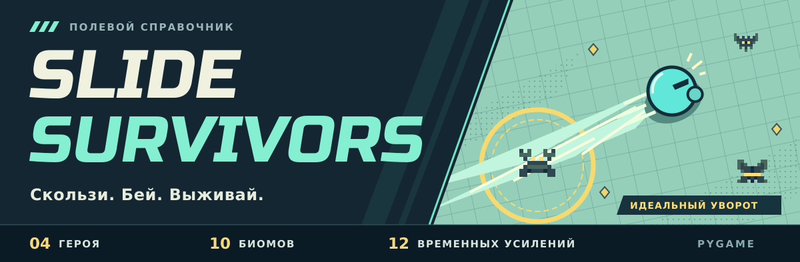

[English](README.md) · **Русский**

# Slide Survivors

Арена-рогалик с видом сверху на Pygame. Герой бьёт кулаками сам, а ты выбираешь направление удара и ведёшь его в скольжении. Проскочи мимо краба в последний момент, развернись с заряженным круговым ударом и подбери опыт, пока не подошла следующая волна.

## Начать забег

Понадобятся Python 3 и pip. Из папки проекта выполни:

```bash
python -m pip install -r requirements.txt
python main.py
```

При первом запуске выбери русский или английский язык. В меню **«Персонажи»** доступны **Слайдер**, **Боец**, **Молния** и **Тень**. Их можно листать и стрелками на карточке в главном меню. Выбор героя не запускает таймер: когда будешь готов, нажми **1 — Играть**. Шрифты для обоих языков, значков и монохромных эмодзи уже в комплекте — устанавливать их в систему не нужно.

## Управление

| Действие | Что нажать |
| --- | --- |
| Движение и прицеливание | WASD или стрелки — идти, мышь — направлять удары |
| Скольжение | Удерживай пробел или Shift; отпусти, чтобы остановиться |
| Дэш-атака | ЛКМ сразу после скольжения |
| Ультимейт | Q или ПКМ, когда накопится заряд |
| Выбор улучшения | 1–3, клик по карточке или стрелки влево/вправо и Enter |
| Пауза | Esc или P |

В меню с номерами цифра работает как клик по соответствующей кнопке. Подходят и верхний ряд, и цифровой блок. В настройках цифра меняет значение в этой строке. **Пауза → Сдаться** завершает забег: результат попадёт в ту же локальную таблицу рекордов по тем же правилам, что и при поражении.

## Как выжить на арене

- **Смотри на замах, а не только на врага.** Выйди из кольца ближней атаки, пока оно не заполнилось. Для идеального уворота нужно именно *выскользнуть* за край в последние 0,16 секунды, когда кольцо побелеет. Кулаки засветятся — следующий взмах ударит по кругу. У стрелков вместо кольца важна линия прицела: уходи вбок, а не прямо назад.
- **Серия кулаков и серия убийств — разные вещи.** Взмах продвигает серию кулаков только при попадании и лишь на один шаг, даже если задел толпу. С улучшением «Прорубающий удар» каждое четвёртое попадание становится круговым. А серия убийств даёт бонус к опыту. Подбор бомбы прибавляет **5 секунд** к оставшемуся времени активной серии, даже если вокруг уже никого нет.
- **Подбирай улучшения под свой манёвр.** Собирай сферы опыта, чтобы получать уровни и выбирать карточки. «Ледяной след» не даёт преследователям повернуть на льду: дождись, пока они въедут на него, и сверни. «Аура отпора» расталкивает толпу, «Аура голода» вытягивает здоровье у ближайшего врага, а «Поле стазиса» замедляет снаряды. С боссом придётся сражаться внутри стен его арены.
- **Не путай добычу с постоянными улучшениями.** Помимо аптечек, магнитов, бомб и ускорителей, из врагов выпадают **12 временных усилений**. Угольный перец усиливает кулаки, Рубиновый клык лечит при попадании, Кометный воск ускоряет скольжение. Эти двенадцать бонусов действуют **8–12 секунд** игрового времени. Разные эффекты сочетаются, а повторный подбор того же предмета обновляет таймер, не удваивая силу. Значки с отсчётом видны над полосой опыта.

## Полевой справочник

На одной карте соседствуют десять биомов. У каждого — свой оттенок земли, две особые декорации и местный обитатель. В новом забеге порядок биомов меняется, но если вернуться в знакомое место в том же забеге, декорации останутся там же. Ракушка на берегу — часть пейзажа, а не предмет для подбора.

| Биом | Обитатель | Биом | Обитатель |
| --- | --- | --- | --- |
| Цветущий луг | Клеверный мотылёк | Базальтовая пустошь | Шлаковый слизень |
| Янтарные дюны | Песчаный скорпион | Хрустальные пещеры | Гулкая мышь |
| Ледяное плато | Инейная рысь | Приливный берег | Приливный краб |
| Камышовая топь | Камышовая жаба | Старая литейная | Шестерёнчатый клещ |
| Багряная роща | Шипастый олень | Забытые руины | Рунный огонёк |

Местный моб погибает, если пересечёт границу своего биома, даже от отбрасывания. Это способ оторваться от погони, но **убийство не засчитается**: ни опыта, ни комбо, ни предмета, ни тела для некроманта. На обычных врагов и боссов граница не действует.

## Для разработчиков

- Запустить тесты: `python -m unittest discover -s tests`.
- Для игры с трейнером запусти `python cheat_launcher.py` **вместо** `main.py`, затем нажми F1, чтобы открыть его панель.
- Код игры распространяется по [лицензии MIT](LICENSE). У [шрифтов в комплекте](assets/fonts/README.md) свои лицензии.
